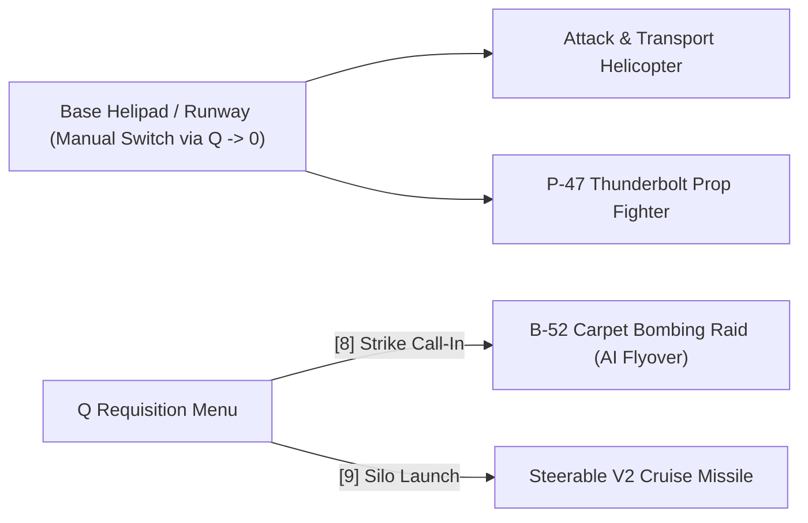

# Glory Days Web — Game Design & Technical Specification (v2.0)

> **Inspiration:** *Glory Days 2* (Nintendo DS) / *Super Army War* (GBA)  
> **Core Blend:** 2.5D Side-Scrolling Arcade Air Combat + Lane-Based Real-Time Strategy (RTS)  
> **Multiplayer:** Server-Authoritative Browser PvP & Co-op (1v1, 2v2, 3v3) + AI Bot Commanders  

---

## 1. Core Architecture & Tech Stack

* **Client Stack:** TypeScript + Vite, **Three.js** (2.5D Sprite & Parallax Stage Renderer) or 2D Canvas/Pixi-style Sprite Pipeline, HTML/CSS/Canvas (DS-Inspired Dual-Screen Tactical HUD).
* **Server Stack:** Node.js + WebSockets (`ws`) running a deterministic **60 Hz fixed-timestep** authoritative simulation.
* **Shared Simulation Core (`shared/`):**
  * All gameplay physics, hitboxes, projectile ballistics, bunker captures, and ground unit AI run on a strict **2D X-Y plane** (`X` = horizontal battlefield position, `Y` = altitude above ground), shared identically between server and client.
  * **Sprite-Based 2.5D Visual Pipeline:** All aircraft, ground vehicles, troops, civilians, bunkers, and HQ structures render using **high-detail generated 2D side-profile transparent PNG sprites** (`public/assets/sprites/*.png`) mounted on textured sprite planes/billboards inside a layered 2.5D parallax battlefield (no boxy low-polygon geometry), paired with dynamic animated overlays for spinning rotors/propellers, muzzle flashes, rocket exhaust trails, and volumetric explosions.
* **Networking Model:**
  * **Server-Authoritative Tick:** 60 Hz simulation tick with 20 Hz delta/snapshot broadcasts for ground units, bunkers, civilians, and projectiles.
  * **Client-Side Prediction & Reconciliation:** Local aircraft movement and weapon inputs apply immediately on the client and reconcile smoothly against server state for crisp, responsive flight.

---

## 2. Battlefield & Map Layout

* **World Dimensions:** `12,000m` wide (`X: -6000` to `+6000`) × `1,200m` flight ceiling (`Y: 0` to `1200`).
* **Base HQ Complexes (Team A at `X: -5400`, Team B at `X: +5400`):**
  * **Command HQ Building (`5,000 HP`):** Primary win/loss objective. Destroying the enemy HQ wins the match immediately.
  * **Helipad & Runway:** Dedicated landing zone at the rear/front of Base. Smooth touchdown automatically triggers repairs, ammo/flare restock, and civilian evacuation (with **no blocking popup**).
  * **V2 Missile Silo:** Launches player-steered V2 Cruise Missiles.
  * **Base AA Battery:** Automated flak & SAM defenses protecting the HQ/Runway zone from spawn-camping.
* **Checkpoints / Bunkers (5 to 7 along the battlefield, e.g., `X: -3600, -1800, 0, +1800, +3600`):**
  * **States:** `Neutral`, `Team A`, `Team B`, or `Neutralized (0 HP)`.
  * **Infantry-Only Capture Rule:** Tanks, APCs, AA trucks, and aircraft **cannot** capture bunkers. Only **Infantry** (marching on foot or airdropped from a Helicopter as **Paratroopers**) can enter and capture a `Neutral` or `Neutralized` bunker.
  * **Captured Benefits:** Restores to `1,000 HP`, fires defensive bursts at approaching enemies, and increases the team's passive **War Funds** income rate.
* **Civilian Villages / Warzones:**
  * Located between bunker sectors. Periodically spawn stranded **Civilians** who wave distress signals and seek shelter until picked up by a friendly **Helicopter** or **Ambulance**.

---

## 3. Playable Aircraft Classes (Switchable Manually at Base)

Players choose their starting aircraft before launch and can switch freely whenever landed on their friendly Base Helipad/Runway via the manual **`Q` -> `[0]`** action (**never** triggered automatically upon landing).

### Class 1: Attack & Transport Helicopter (*"Yelling Dog / Huey"*)
* **Flight Model:** *Choplifter*-style 2D arcade physics. Vertical takeoff/landing anywhere, can fly backward or flip horizontal facing direction (`Left`/`Right` thrust & tilt), pitches nose-down proportionally to forward horizontal speed. When hovering hands-off with no vertical input (`Up`/`Down`), gravity gently pulls the helicopter downward (`~24 u/s` sink rate) until it lands.
* **Stats:** `350 HP` | Max Speed: `280 u/s` | Cabin Capacity: **8 Passengers** (Infantry or Civilians).
* **Weapons & Loadout:**
  * **Primary (`A`):** Forward Cockpit Autocannon aimed straight ahead (`0°` relative to nose, firing along the helicopter's current pitch angle). Uses the **Burst-Fire Reservoir** mechanic. Effective against infantry, light vehicles, and enemy aircraft.
  * **Secondary (`S`):** **12x Free-Drop Gravity Bombs** (finite capacity; drops straight downward with **100% of the helicopter's current `(vx, vy)` momentum** so pilots can aim straight down while hovering or lead targets while flying forward).
  * **Countermeasure (`Z`):** **4x Flares** (finite capacity; spoofs incoming ground AA SAMs).
* **Transport & Rescue Utility (`E`):**
  * **Airborne (`E`):** Drops 1 loaded friendly Infantry as a **Paratrooper** with a parachute directly onto bunkers or behind enemy lines.
  * **Landed at Base (`E`):** Manually loads waiting friendly Infantry into the cabin (or unloads them).
  * **Civilian Rescue:** Landing or hovering low (`<15m`) near stranded Civilians automatically boards them into available cabin slots; touching down at Base unloads them for team cash.

### Class 2: Prop Fighter Plane (*"P-47 Thunderbolt"*)
* **Flight Model:** Highly maneuverable WWII/Cold-War heavy prop fighter replacing the supersonic jet. Takes off and lands along the Base Runway.
  * **Throttle & Pitch Separation + Stall Glide-to-Nose-Dive:** **`Left` / `Right` Arrows** control forward thrust/velocity (and trigger wide U-turns when reversed); **`Up` / `Down` Arrows** only change nose pitch and vertical direction without accelerating or braking the plane's scalar airspeed. Releasing `Left`/`Right` causes air drag deceleration (`135 u/s²`); dropping below the lift threshold (`stallSpeed = 220 u/s`) transitions the plane from a shallow glide into a forward-angled nose-dive (up to `-0.62 rad` / `~-35°`, keeping forward dive momentum alive rather than dropping straight down vertically). Pulling `Up` while stalled cannot climb until thrust restores speed above `220 u/s`.
  * **Gentle Sine-Wave Vertical Cruise:** The P-47 cannot fly in a dead-flat horizontal line; while traversing the map horizontally, aerodynamic trim imparts a subtle, shallow-amplitude, long-wavelength vertical sine-wave oscillation ($y_{\text{osc}}(t) = A \sin(\omega t)$ with wide distance between peaks) paired with a gentle matching nose-pitch tangent oscillation ($\Delta \theta(t)$) so the plane smoothly rises and dips across long stretches.
  * **Wide U-Turn Momentum:** Reversing horizontal direction executes a wide banking U-turn (`0.8s` duration) where horizontal velocity follows $v_x(p) = v_{\text{cruise}} \cdot \cos(\pi p)$ for $p \in [0, 1]$, carrying forward travel into the bank (`p = 0 → 0.5`), pivoting through the 90° wing-over apex (`p = 0.5`), and accelerating smoothly into the opposite direction (`p = 0.5 → 1.0`).
* **Stats:** `300 HP` | Cruise/Max Speed: `420 / 540 u/s` | Lift Stall Threshold: `220 u/s` (min glide `175 u/s`) | Cabin Capacity: **0**.
* **Weapons & Loadout:**
  * **Primary (`A`):** Twin Wing-Mounted .50 Cal / 20mm Autocannons firing straight along the plane's nose vector. Uses the **Burst-Fire Reservoir** mechanic. High DPS for dogfighting and strafing.
  * **Secondary (`S`):** **8x Unified Straight-Trajectory Fuel-Limited Missiles/Rockets** (finite capacity):
    * **No Heat-Seeking & No Air/Ground Split:** Missiles do not lock on and make no distinction between air and ground targets—they hit *any* enemy aircraft, B-52, V2 missile, ground vehicle, bunker, or HQ in their path.
    * **Ballistics & Fuel Cutoff:** Each missile launches straight along the exact continuation of the plane's current trajectory/nose vector. It flies under rocket power in a straight line for **1/3 of the map width (`4,000m`)**, at which point its fuel runs out, its smoke trail cuts off, and it falls ballistically under gravity.
  * **Countermeasure (`Z`):** **6x Flares** (spoofs ground AA SAM locks).

---

## 4. Primary Weapon (`A`): Burst-Fire Reservoir Mechanic

Instead of an overheat lockout, the primary cannon can **always fire**—rewarding trigger discipline with high-cadence bursts while allowing continuous suppressive fire at a slower cadence once the burst buffer empties.

* **Simulation Tick Rate:** `60 Hz` (`1 tick = 16.67ms`).
* **Burst Reservoir Capacity:** `90 ticks` (`1.5 seconds` of continuous rapid fire).
* **Burst Fire Mode (Reservoir > 0):** Fires **1 round every `5 ticks`** (`12 rounds/sec`). Each tick holding `A` drains `1 tick` from the Burst Reservoir.
* **Sustained Slow Fire Mode (Reservoir == 0):** Automatically steps down to **1 round every `30 ticks`** (`2 rounds/sec`, i.e., `1 shot per 0.5s`) for as long as `A` remains held.
* **Recharge Behavior:** After **`120 ticks` (`2.0 seconds`)** of not pressing `A`, the Burst Reservoir recharges back to `100%` (`90 ticks`, filling over `30 ticks` / `0.5s`).

---

## 5. Requisition Menu (`Q`) — Ground Units & Strategic Call-Ins

Pressing **`Q`** toggles the **Requisition / Purchase Menu** overlay above the Tactical Command Bar. Every purchasable unit, tactical call-in, and base action clearly displays its **key number (`1`–`9` & `0`)**, **icon**, **name**, and **cost** in **Shared Team War Funds ($)**.

| Key | Unit / Strategic Asset | Cost | HP | Speed | Role & Mechanics |
| :---: | :--- | :---: | :---: | :---: | :--- |
| **`1`** | **Infantry Squad** | \$50 | 40 | Slow | Marches down the lane; **the only unit that can capture Bunkers**. Can board a friendly Helicopter at base via `E` to become Paratroopers. |
| **`2`** | **AA Flak / SAM Truck** | \$150 | 140 | Fast | Fires upward-tracking flak bursts and short-range SAMs at enemy aircraft. Shreds helicopters and low-flying fighters; weak against armor. |
| **`3`** | **Armored APC** | \$225 | 300 | Med-Fast | Mechanized anti-infantry / anti-AA support vehicle; deploys 2 infantry upon reaching a neutral bunker or upon destruction. |
| **`4`** | **Main Battle Tank (MBT)** | \$400 | 650 | Medium | Backbone of the ground assault. Fires heavy armor-piercing shells at ground units, bunkers, and HQ. Takes **1.75x bonus damage** when bombed from behind. |
| **`5`** | **Self-Propelled Howitzer (Heavy Tank)** | \$650 | 1,000 | Slow | **Oversized heavy tracked tank** featuring a massive boxy artillery turret and long high-caliber howitzer cannon. Fires devastating high-explosive shells that crush enemy tanks, bunkers, and HQ from longer standoff range. |
| **`6`** | **Ambulance** | \$120 | 150 | Fast | Unarmed rescue vehicle. Drives automatically to the nearest stranded Civilians, boards up to 6, and returns them to HQ for shared team funds. |
| **`7`** | **Supply / Ammo Truck** | \$200 | 180 | Medium | Drives behind the frontline; repairs nearby friendly armor (`+25 HP/s` aura) and replenishes allied ammunition. |
| **`8`** | **B-52 Carpet Bombing Raid** | \$750 | 900 | High Alt | **Tactical Power-Up Call-In (Not playable).** Pressing `8` opens an X-strip target reticle on the tactical radar (move with `Left`/`Right` arrows, confirm with `S`/`Enter`). A giant high-altitude **B-52 Stratofortress** enters from friendly airspace, flies across the chosen target strip (`1,500m` zone), and drops 24 heavy carpet bombs across the land. (Can be intercepted by daring enemy P-47s climbing to high altitude!) |
| **`9`** | **Steerable V2 Cruise Missile** | \$850 | 120 | Very Fast | **Base Silo Launch.** Launches from the team's V2 Silo. The launcher's camera transfers to the missile so they can steer it manually with **`Arrow Keys`** into enemy tank columns, bunkers, or HQ for massive AoE damage. Interceptable by enemy aircraft or AA! |
| **`0`** | **Swap Aircraft Class** | Free | — | — | **Available only when smoothly landed on Base Helipad/Runway.** Manually swaps between **Helicopter** and **P-47 Thunderbolt**. |

---

## 6. Team Modes, Shared Economy & Resupply Loop

### A. Match Modes & Shared Team Funds
* **Modes:** **1v1 Duel**, **2v2**, and **3v3** Team Battles (AI Bot Commanders can fill any empty slot for solo, co-op, or mixed matches).
* **Shared Team War Funds Pool:** All teammates on the same side share a **single unified War Funds balance**, shared HQ health, shared Bunker income, and shared Civilian evacuation payouts. Coordination matters: one player can fly a Helicopter rescuing civilians and dropping paratroopers while a teammate flies air cover in a P-47 Thunderbolt and spends shared funds on Self-Propelled Howitzers or a B-52 raid.

### B. Income & Civilian Rescue Economy
* **Starting Team Funds:** `$500` (scales slightly or stays unified per team).
* **Passive Income Tick (every `1.0s`):**
  $$\text{Team Income/sec} = \$10\text{ (HQ)} + (\$6 \times \text{Controlled Bunkers})$$
* **Civilian Rescue Multiplier:** Returning $N$ civilians safely to Base (via Helicopter touchdown or returning Ambulance) awards:
  $$\text{Payout} = \$40 \times N + \$15 \times N^2$$
  *(1 civilian = `$55`, 4 civilians = `$400`, full 8-passenger Helicopter = `$1,280`!)*
* **Collateral Penalty:** Killing a civilian with friendly fire deducts **`$100`** from the team's War Funds.

### C. Landing Pad / Runway Resupply (No Auto-Prompt)
* Touching down smoothly (`vertical speed < 40 u/s` and `pitch < 20°`) on the friendly Base pad automatically:
  1. Repairs hull HP (`+100 HP/s`).
  2. Restocks finite secondary rockets/bombs and flares (`1 unit per 0.5s`).
  3. Unloads any rescued civilians in the Helicopter cabin for immediate cash.
* **No Automatic Modal:** Landing **never** hijacks the screen with an automatic swap/load popup. Players remain in control and press **`E`** to load/unload troops or **`Q` -> `0`** to switch aircraft whenever desired.
* **Proportional Ground Damage, Bounce & Crash-Landing Slide:** Touching ground outside the friendly airstrip or landing too hard (`|vy| > 45 u/s` or `|pitch| > 0.26 rad`) on the friendly airstrip inflicts damage proportional to impact vertical speed and total plane momentum:
  * **Survivable Impact (`HP > 0`):** The plane bounces back up into the air (`48–125 u/s` upward velocity, nose pitched slightly up) with reduced forward speed so the pilot can recover.
  * **Fatal Impact (`HP <= 0`):** Enters a fiery **crash-landing ground slide** (`~1.1s`), skidding forward along `y = 0` and **destroying any ground vehicles or troops in its path** before detonating (`3s`–`5s` respawn delay + `$100` team replacement cost).

---

## 7. Controls (Strictly Keyboard — No Mouse Controls)

All flight, combat, troop handling, and RTS purchasing are designed for pure keyboard play (zero mouse clicks or cursor aiming required):

| Key | Context | Action |
| :---: | :--- | :--- |
| **`Arrow Keys`** (`←` `→` `↑` `↓`) | Flight / V2 / B-52 Aim | Pilot Helicopter or P-47 Thunderbolt; steer launched V2 Cruise Missile; move B-52 Carpet Bomb target strip when confirming `[8]`. |
| **`A`** | Combat | Fire **Primary Gun** (rapid burst for `1.5s` / `90 ticks`, then `1 shot / 0.5s`; recharges after `2.0s` idle). |
| **`S`** | Combat / Confirm | Fire **Secondary Weapon** (Helicopter Bombs/Rockets; P-47 Straight-Trajectory Fuel-Limited Missile). Also confirms B-52 target strip if active. |
| **`Z`** | Defense | Deploy **Flares** to spoof incoming AA SAM missiles. |
| **`Q`** | RTS Command | Toggle **Purchase / Requisition Menu** (shows items with keys `1`–`9` & `0`). |
| **`1`–`9`, `0`** | With `Q` Menu Open | Requisition corresponding ground unit (`1`–`7`), call B-52 Raid (`8`), launch V2 Missile (`9`), or Swap Aircraft at Base (`0`). |
| **`E`** | Helicopter Utility | **In Air:** Drop 1 loaded Infantry as a Paratrooper. **On Ground at Base:** Load waiting friendly Infantry into cabin or unload carried troops. |

---

## 8. DS-Inspired Dual-Screen HUD Layout

* **Top ~80% — 2.5D Sprite-Based Action Viewport:**
  * Textured transparent PNG unit sprites rendered with crisp pitch/tilt transforms, team-color tinting/insignia variants, animated rotor/prop overlays, and multi-layer parallax terrain & sky depth.
  * Dynamic look-ahead camera that zooms slightly out at high P-47 airspeeds and zooms in during low Helicopter rescues.
  * Top-center **Territory Tug-of-War Bar** displaying Team A / Team B HQ health, bunker ownership icons, and **Shared Team War Funds ($)**.
  * Clean diegetic warnings (`SAM LOCK — PRESS Z`, `LOW FUEL`, `REAR HIT x1.75`).
* **Bottom ~20% — Tactical Command Deck:**
  * **Full-Map Live Radar Strip:** Displays the entire `12,000m` frontline—bunkers, ground columns, civilian distress beacons, B-52 carpet-bomb target zone, and aircraft blips.
  * **Ordnance & Burst Gauge:** Visual Burst-Fire Reservoir bar, Secondary Missile/Bomb pips, Flare pips, Hull HP, and Helicopter Passenger Slots (`0/8`).
  * **Toggleable `Q` Requisition Drawer:** Pops open cleanly along the command deck showing numbered hotkeys `[1]`–`[9]` + `[0]` without obscuring your aircraft in the sky.

---

## 9. Canonical Unit Scale & Sprite Animation Specification

### A. Relative World Scale Table (`1.0x` Camera Zoom)
All entities respect realistic relative military proportions so soldiers and civilians never tower over trucks, tanks, helicopters, or buildings:

| Entity / Structure | World Scale (Meters) | Screen Render Size (`1.0x` Zoom) | Relative Visual Anchor |
| :--- | :---: | :---: | :--- |
| **Infantry Soldier** | `2.0m` tall | `22px` tall | ~1/3 height of vehicles; fits inside Helicopter cabin door & Bunker door |
| **Stranded Civilian** | `2.0m` tall | `22px` tall | Same human scale as Infantry; distinct bright orange flare & jacket |
| **Paratrooper (Open Canopy)** | `4.6m` tall | `62px` tall | Soldier body inside is exact `22px` Infantry scale under canopy |
| **AA Flak / SAM Truck** | `8.5m` wide | `92px × 58px` | ~2.6× taller than Infantry |
| **Ambulance / Supply Truck / APC** | `8.8m–9.5m` wide | `94–104px × 48–56px` | Consistent military vehicle wheel/chassis scale |
| **Main Battle Tank (MBT)** | `10.5m` wide | `124px × 46px` | Sleek low-profile armor hull |
| **Self-Propelled Howitzer** | `13.5m` wide | `160px × 68px` | Noticeably larger chassis, oversized boxy turret, long heavy cannon |
| **Attack Helicopter** | `12.0m` wide | `136px × 68px` | Cabin door tall enough for `22px` Infantry/Civilians to board |
| **P-47 Thunderbolt** | `11.0m` wide | `126px × 54px` | Comparable wingspan/fuselage length to Helicopter |
| **B-52 Heavy Bomber** | `22.0m` wide | `240px × 90px` | Massive strategic aircraft dominating high altitude |
| **Fortified Bunker** | `10.5m` wide | `118px × 96px` | Concrete pillbox dwarfing Infantry (`22px`) while matching Tank armor scale |
| **Base HQ & Helipad** | `18.0m` wide | `190px × 155px` | Command tower & landing deck large enough to park Helicopter/P-47 |
| **V2 Launch Silo** | `14.0m` wide | `135px` tall | Tall launch gantry towering over ground armor |

### B. Sprite Animation Frame Cycles & Canvas Alignment
* **Uniform-Canvas Sprite Alignment:** All multi-frame aircraft animation sheets (`heli_fly_1..3` at `424×266`, `heli_turn_1..3` at `430×284`, and `p47_fly_1..3` at `442×190`) lock exact canvas dimensions and fuselage/skid anchor positions so spinning rotors/propellers never cause hull size jitter. Banking frames (`p47_turn_1..3`) render at a constant pixel-to-world ratio matching `p47_fly_*`.
* **Helicopter (`heli_fly_1..3` + `heli_turn_1..3`):**
  * **Rotor Spin:** Cycles `heli_fly_1 → heli_fly_2 → heli_fly_3` at high speed (~20 fps) for continuous main/tail rotor rotation.
  * **Turn-Around Bank (`Right ↔ Left`):** Transitions smoothly through `fly → turn_1 (30°) → turn_2 (60°) → turn_3 (90° front hover) → mirrored turn_2 → mirrored turn_1 → mirrored fly` with light damped horizontal drift.
* **P-47 Thunderbolt (`p47_fly_1..3` + `p47_turn_1..3`):**
  * **Propeller Spin:** Cycles `p47_fly_1 → p47_fly_2 → p47_fly_3` (~24 fps) for crisp nose propeller motion.
  * **Wide U-Turn Roll (`Right ↔ Left`):** Transitions smoothly across `0.8s` through `fly → turn_1 (30° bank) → turn_2 (60° steep bank) → turn_3 (90° elliptical wing turn) → mirrored turn_2 → mirrored turn_1 → mirrored fly`, driven by continuous horizontal momentum $v_x(p) = v_{\text{cruise}} \cdot \cos(\pi p)$.
* **Unified Paratrooper → Infantry (`para_sway_1..2` → `para_land_collapse` → `inf_turn` + `inf_run_1..4`):**
  * Both states use the **exact same olive-drab soldier character**.
  * Air descent sways between `para_sway_1` and `para_sway_2`.
  * Ground touchdown triggers `para_land_collapse` (knees bent, rifle raised, parachute deflating behind back) for `~0.35s` before seamlessly entering the 4-frame `inf_run_1..4` march/run cycle (`inf_turn` when reversing direction).
* **Civilian (`civ_wave_1..2`, `civ_turn`, `civ_run_1..3`):**
  * Idles/signals in distress alternating `civ_wave_1 ↔ civ_wave_2`.
  * When a friendly Helicopter lands nearby or an Ambulance approaches, pivots via `civ_turn` and sprints toward extraction using the 3-frame `civ_run_1..3` cycle.
